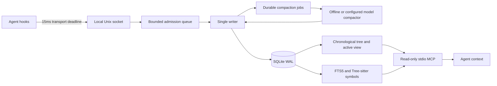

# FractalMem

FractalMem is a local memory engine for long coding-agent sessions. It keeps a redacted event log on disk, compresses chronological spans into a hierarchical view, and retrieves exact code symbols and text through SQLite and stdio MCP.

The implementation is being built against the [architecture and acceptance plan](plans/01-architecture-and-acceptance.md). Phase status and executed evidence are recorded in the [execution ledger](plans/03-execution-ledger.md). The original proposal documents contain reference measurements and unexecuted hypotheses; they are not benchmark results for this repository.

## Architecture

Each node covers a power-of-two span of messages. Sibling merge priority uses the age of the pair's last message: `(T - last) / 2**level`. The visible buffer grows by appending stable lines until it crosses 128,000 bytes; a batch then merges eligible spans toward 64,000 bytes. A batch can remain pending while summaries are built. Raw redacted events remain retrievable after summaries lose detail.

The prompt builder uses the same constant system and tool definitions for turns and compaction. Stable byte prefixes make provider cache reuse possible. Actual cache rates depend on the provider, model, cache lifetime and request contents and must be measured from real usage responses.

## Evidence and limitations

* One retrieval tool call returns matches and chronological handles. SQLite search runtime depends on corpus size and matches.
* A portable Python queue uses short synchronization sections; it is not a formal lock-free MPSC implementation.
* The hook deadline bounds socket waiting. It is not a hard real-time guarantee under arbitrary operating-system load.
* Queue admission and durable SQLite commit are different states. A fail-open hook can lose events on overload or process failure before commit; durable barriers must be used when required.
* Redaction and nonce framing reduce risk. They do not prove that every possible secret or prompt injection will be detected.
* MCP provides memory tools. Host agents must explicitly integrate the memory view into their prompts to obtain prefix stability; registering tools alone does not replace host compaction.

## Benchmarks

The [benchmark methodology](plans/04-benchmark-methodology.md) defines actual disk, UDS, retrieval and prefix tests, plus LoCoMo and LongMemEval dataset evaluation. Synthetic regression tests, real dataset retrieval metrics and model-generated answer accuracy are reported separately. Provider token usage, cache and TTFT values remain unmeasured unless actual provider responses or stream events were captured.

LoCoMo source data is licensed CC BY-NC 4.0 and is downloaded separately. It is not distributed under the package code license. LongMemEval cleaned and V2 data are separate benchmark versions. Dataset downloads remain outside Git; results record provenance and content hashes.

## Development and coordination

The [AGY prompt](plans/02-agy-fractal-prompt.md) requires phased implementation, real tests and adversarial self-review. Principal review follows before each milestone commit and push. A read-only Herdr monitor can be run inside the active Herdr session with `python3 plans/monitor_agy.py`; it observes lifecycle state without sending agent input.

Repository: https://github.com/Heman10x-NGU/fractal-mem

## References

The chronological tree and rollback merge approach builds on [Victor Taelin's UniiChat recipe](https://gist.github.com/VictorTaelin/91837951a5ce5b38f341ec1ba1df6449). FractalMem adds scoped storage, direct symbol/text retrieval, daemon ingestion and security boundaries. Primary benchmark references are [LoCoMo](https://github.com/snap-research/locomo) and [LongMemEval](https://github.com/xiaowu0162/LongMemEval).
