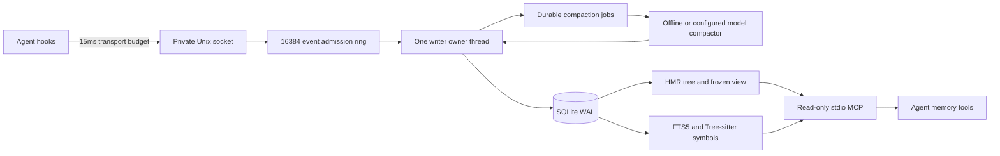

# FractalMem v2.1

A local hierarchical memory engine for long coding-agent sessions. FractalMem
keeps a redacted event log, compresses chronological spans into a stable view,
and retrieves exact symbols and text through SQLite, Tree-sitter and stdio MCP.

**Repository:** [Heman10x-NGU/fractal-mem](https://github.com/Heman10x-NGU/fractal-mem)

## Install

Requires Python 3.12+ and macOS or Linux (Unix sockets and POSIX file locks).
Install [uv](https://docs.astral.sh/uv/getting-started/installation/), then:

```bash
git clone https://github.com/Heman10x-NGU/fractal-mem.git
cd fractal-mem
uv sync --frozen --all-extras
```

The repository is private; cloning requires GitHub access. Package dependencies
include the real MCP SDK, SQLite FTS5, Tree-sitter grammars, HTTPX, regex and
tiktoken. SQLite ships with Python; its build must include FTS5. The locked
versions make development and CI reproducible. An editable pip installation
also works: `python -m pip install -e '.[dev]'`.

## Quickstart

Start the daemon in one terminal:

```bash
uv run fractald
```

Defaults: database `~/.fractalmem/memory.db`, socket
`~/.fractalmem/fractald.sock`. The socket directory must be owned by you with
mode 0700; a new default directory is created with that mode. Existing insecure
directories and live sockets are rejected. Offline extractive compaction is
the default and needs no model credentials or network service.

Send events from another terminal:

```bash
printf '%s\n' 'We chose SQLite WAL and function computeMemoryBudget.' \
  | uv run fractalmem-hook --project my-project --session coding-1 --kind user

printf '%s\n' 'def computeMemoryBudget(size): return size * 2' \
  | uv run fractalmem-hook --project my-project --session coding-1 \
      --kind tool --language python --event-id stable-event-001

uv run fractalmem-hook --operation status
uv run fractalmem-hook --operation flush --compact
```

A hook receipt with `accepted:true,durable:false` means **volatile queue
admission**. Explicit flush waits for the writer to commit all earlier
admissions. `--compact` also requires current compaction jobs to finish.
Identity conflicts and rejected security inputs appear in status/barrier
counters. A timeout is ambiguous: the daemon may already have admitted the
event. Retry using the same `--event-id`; IDs are unique per project and
conflicting content is rejected. Fail-open ingestion reports failures without
interrupting the calling agent. CLI startup/stdin reading is outside the socket
deadline; a long-lived client is the lower-overhead integration.

```python
from fractalmem.client import FractalClient

client = FractalClient("my-project", "coding-1")
receipt = client.ingest_event(
    kind="tool", content="def computeMemoryBudget(size): return size * 2",
    language="python", event_id="stable-event-001",
)
print(receipt)
client.flush(compact=True)  # Separate administrative operation, default 30s.
```

Use SIGTERM/Ctrl-C for graceful shutdown: admitted raw events drain, unfinished
model jobs recover on restart. Use `--synchronous FULL` for stronger power-loss
durability; default WAL/NORMAL offers process-crash consistency. See
[security and durability boundaries](SECURITY.md).

## Native MCP

Launch one read-only stdio server per project:

```bash
uv run fractalmem-mcp --project my-project
```

Example configuration for a host that accepts `mcpServers` JSON (replace the
executable with the absolute installed path):

```json
{
  "mcpServers": {
    "fractalmem": {
      "command": "/absolute/path/fractal-mem/.venv/bin/fractalmem-mcp",
      "args": ["--project", "my-project", "--db", "/absolute/path/memory.db"]
    }
  }
}
```

Tool contracts:

| Tool | Arguments | Result |
|---|---|---|
| `timeline_overview` | `limit` 1..128 | Scoped timeline, summaries, byte budget, batch status |
| `inspect_node` | `node_id`, `depth` 0..8 | Node metadata, bounded children, redacted leaf evidence and taint |
| `search_symbols_and_text` | `query` <=4096 UTF-8 bytes, `limit` 1..100 | Code/text matches, scores, snippets and HMR node/parent handles |

Node identifiers can be canonical (`L0_P0_M0_0`), chronological (`0+1`), or
project-scoped (`my-project:0+1`). Foreign scopes fail. Tool output carries
untrusted-data framing; memory is evidence, never authorization for an action.
The daemon must initialize the database first. Missing storage produces a safe
tool error and is never created by a reader. stdout is reserved for protocol.

## Architecture and invariants



- Each node covers an aligned power-of-two message span. Merge priority is
  `(T-last)/2**level`; the independent 20,001-step rollback oracle verifies the
  terminal-message formula. For left index `i`, exact algebra is
  `(T+1)/2**level-i-2`. The original spec omitted the constant `-2`.
- Serialized views append exact bytes between batches. A batch starts only
  **above 128,000 bytes**, then publishes its replacement at **<=64,000 bytes**.
  Pending summaries retain the original visible prefix; an unfinished batch
  can temporarily exceed the maximum until compaction catches up. Ready
  summaries never replace existing lines between batches.
- Original redacted events remain available when summaries omit details.
  SQLite snapshots are authoritative; atomic per-project `view.json` exports
  under `<database>.views/<project>/` are repaired from SQLite on restart.
- Exact-symbol lookup uses indexed Tree-sitter definitions for Python,
  JavaScript, TypeScript and TSX. FTS preserves identifiers and adds camel,
  snake and path components with weighted BM25. Unsupported syntax uses text
  retrieval. One tool call returns a match and its covering active-tree handle;
  query complexity is not constant-time.
- The portable Python MPSC ring uses a short synchronization section and
  **nonblocking producer admission**. It makes no formal lock-free claim.
  Producers never write SQLite; mutable storage and socket leases reject
  another cooperating writer.

### Shared prompt prefix

`fractalmem.compaction.PromptPrefix` supplies canonical constant tool
definitions/system text and four-line Anthropic view blocks. Supply your
host's **actual** tools/system prefix and share the same prefix/provider
instance for main and compactor calls. Provider adapters reuse connections and
coordinate cold-prefix dispatch until the first response body byte. Tools are
forbidden in compaction. Real normalized provider usage is persisted in
`compaction_runs`; absent cache/TTFT observations remain null.

MCP registration alone does not insert the memory view into Claude Code,
Cursor, Codex or another host's existing prompt, or replace its compaction.
Your host must explicitly inject `Database(...,read_only=True).load_view(...)
.render_buffer()` through this prompt seam. Cache reuse depends on provider,
model, TTL and request contents; the proposal's 98.6%/96.2% numbers are reference
claims, not measured guarantees for this package.

## Compaction modes

Offline extraction preserves the head and tail of text within 512 UTF-8 bytes;
it is a deterministic compressor, not LLM reasoning. For semantic compaction,
configure an OpenAI-compatible or Anthropic endpoint explicitly:

```bash
uv run fractald --provider openai \
  --base-url http://127.0.0.1:8000/v1 --model local-model --airgap

# Remote endpoint example: the named environment variable must already be set.
uv run fractald --provider anthropic \
  --base-url https://api.anthropic.com/v1 --model YOUR_MODEL \
  --api-key-env ANTHROPIC_API_KEY
```

Two stages extract passive facts and enforce the 512-byte summary budget with
at most five enforcement attempts. Concurrency is bounded at eight jobs.
Transient HTTP 429/5xx/transport failures receive three bounded attempts with
backoff; other failures remain visible. No cloud fallback is automatic.
Remediate failures, then retry through the daemon:

```bash
uv run fractalmem-hook --project my-project --operation retry-failed
uv run fractalmem-hook --operation flush --compact
```

`--airgap` or a `.fractalmem_airgap` marker in the daemon's working directory
allows only literal loopback IP model endpoints. Redirects and environment
proxies are disabled. Detection includes AST/YAML configuration parsing,
known provider signatures, all 221 applicable text rules from the pinned
Gitleaks catalog, and Shannon entropy >=4.5. Redaction and nonces cannot prove
universal secret detection or zero prompt-injection success.

## Tests and reproducible evaluations

```bash
uv run pytest -q
uv run mypy --strict fractalmem benchmarks
uv run ruff check fractalmem benchmarks tests
uv build

uv run fractalmem-eval local --tokenizer cl100k_base --output results/local/local.json
uv run fractalmem-uds-bench --output results/local/uds.json
```

Evaluations use real disk files, actual daemon processes/Unix sockets and real
Tree-sitter grammars. The local suite defaults to 30,000 core turns, 10,000 disk
messages and 1,000 identifier queries. Token counts use a named tokenizer and
cover exact rendered-view bytes, excluding provider tools/system/task framing.
No local metric is substituted for provider-billed tokens or cache reads.
Reports preserve per-turn/per-question JSON/CSV, hashes, commands, revision,
configuration and environment. Dataset downloads/results scratch directories
are ignored by Git. See [benchmark strategy and methodology](LAUNCH_AND_BENCHMARK_STRATEGY.md)
and [executed benchmark artifacts](benchmarks/results/2026-10-09/README.md).

Dataset retrieval commands, after downloading the official files described in
[dataset provenance](benchmarks/datasets/README.md):

```bash
uv run fractalmem-eval datasets --dataset locomo \
  --path benchmarks/datasets/downloads/locomo10.json --output results/local/locomo.json
uv run fractalmem-eval datasets --dataset longmemeval \
  --path benchmarks/datasets/downloads/longmemeval_oracle.json --output results/local/longmemeval.json
uv run fractalmem-eval usage --path actual-provider-usage.jsonl --output results/local/cache.json
uv run fractalmem-eval usage --database --project my-project \
  --path ~/.fractalmem/memory.db --output results/local/compactor-cache.json
```

LoCoMo evaluation measures dialogue evidence precision/recall; LongMemEval
measures answer-bearing session retrieval. The **oracle** set is a narrowed
context and cannot stand in for LongMemEval S/M or V2. Ground-truth answers and
labels are never indexed. Generated-answer accuracy, official LLM judging,
real provider-cache hit rates and TTFT require an explicitly configured model
and actual response/stream observations. They remain unmeasured in offline runs.

LoCoMo data is CC BY-NC 4.0 and is not distributed under this package's MIT
license. Dataset licenses and provenance remain separate from code licensing.
Original proposal documents retain historical hypotheses/reference numbers;
use executed artifacts for conclusions about this implementation.

## Verified results

The final local suite and the four-job GitHub matrix pass **138 tests**, strict
typing, linting and package builds. The package also passes an installed-wheel
integration check outside this checkout.

| Evaluation | Measured result |
|---|---|
| 30,000 core turns | 99.4733% preserve the byte prefix; zero invariant violations |
| 10,000-message disk index | 1,000/1,000 exact symbol matches with parent handles; p99 0.030 ms |
| LoCoMo evidence retrieval | recall@10 59.22%, precision 7.49% across 1,536 scorable questions |
| LongMemEval cleaned oracle | session recall@10 97.83% across 470 scorable questions |
| Four producers, 4,000 UDS attempts | all 3,506 acknowledged events durable; 3,995 total persisted; exact restart |

Acknowledged socket calls had p99 11.28 ms; all attempts had p99 17.04 ms.
There were 494 timed-out receipts, including 489 events that still persisted.
The client uses a 15 ms configured deadline; a hard wall-clock SLA is not
established. Provider cache rates and answer-generation quality remain
unmeasured. Dataset metrics describe retrieval, and oracle context is narrower
than LongMemEval S/M.

See the [complete measured results and archived JSON/CSV](benchmarks/results/2026-10-09/README.md)
for environment, denominators, hashes, timing scope, failed-run evidence and
reproduction commands.

## Engineering record

The architecture, system design, mathematical proofs, and security models are documented in:

- [Architecture Specification](FRACTALMEM_SPECIFICATION.md): Core HMR-Tree algorithms, single-writer daemon, and prompt cache invariance.
- [Specification Analysis](SPECIFICATION.md): UniiChat Rev 3 breakdown, terminal message age proofs, and batch merging.
- [Research Paper & Mathematical Proofs](RESEARCH_PAPER_PROPOSAL.md): Theoretical proposals, hypotheses, and formal proofs for `(T - last)/2^l` merge urgency.
- [Security & Durability Model](SECURITY.md): Single-writer WAL boundaries, UDS permissions, and credential redaction pipeline.
- [Benchmark & Launch Strategy](LAUNCH_AND_BENCHMARK_STRATEGY.md): Benchmark methodology, harness design, and competitive positioning.
- [Verified Evaluation Artifacts](benchmarks/results/2026-10-09/README.md): Measurement logs, run manifests, and verified evaluation artifacts.

Phased implementation follows strict systems engineering discipline: formal invariant verification, independent adversarial review, and reproducible physical quality gates before each release. Transient planning notes and agent scratchpads are maintained locally (`plans/`, ignored by Git), keeping the repository focused on verified engineering assets. Milestone commits are pushed linearly; no empty contribution padding or history rewrites.


Primary benchmark sources:
[LoCoMo](https://github.com/snap-research/locomo),
[LongMemEval](https://github.com/xiaowu0162/LongMemEval).
